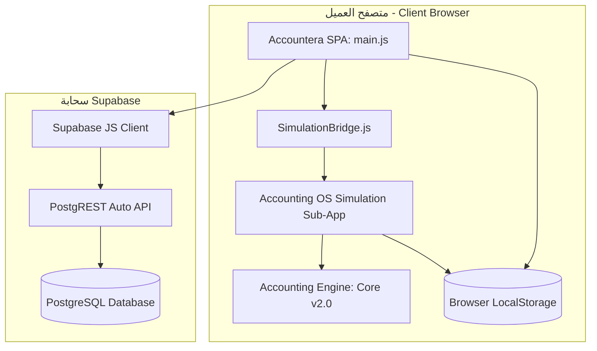
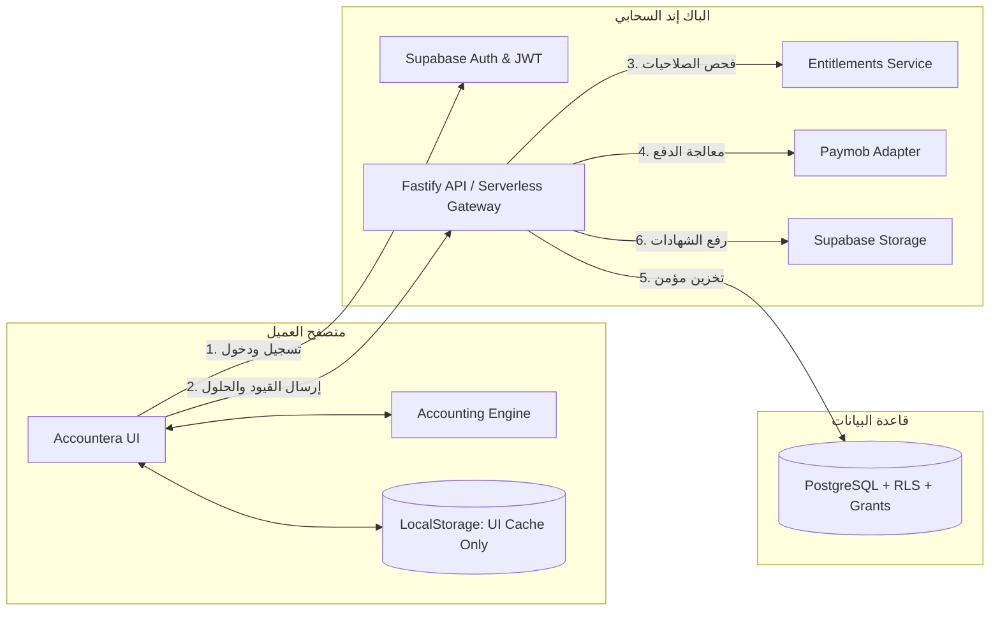
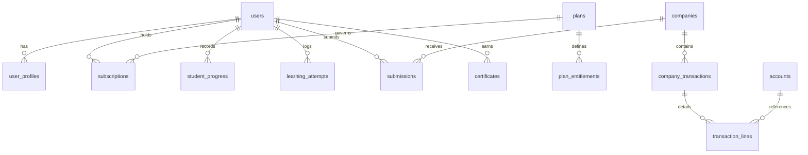
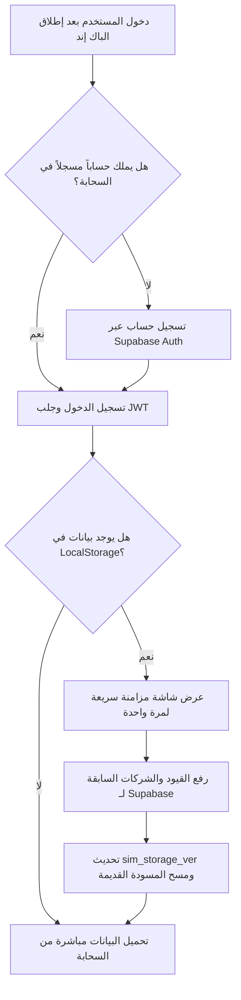

# تقرير الفحص المعماري الشامل لبناء الباك إند الإنتاجي لمنصة Accountera
## Comprehensive READ-ONLY Architecture Audit & Production Backend Blueprint

> **تاريخ الفحص:** 21 سبتمبر 2026  
> **طبيعة الفحص:** فحص معماري وأمني وتحليلي شامل وقراءة فقط (READ-ONLY Architecture Audit)  
> **حالة الكود:** لم يتم تعديل أي سطر برمجي في المشروع، وتم الحفاظ التام على النواة المحاسبية (Accounting Core) وقواعدها كأصل محمي بنسبة 100%.

---

## فهرس المحتويات (29 قسماً إلزامياً)
1. [الملخص التنفيذي (Executive Summary)](#1-executive-summary)
2. [المعمارية الحالية للنظام (Current Architecture)](#2-current-architecture)
3. [القدرات الحالية للباك إند (Current Backend Capabilities)](#3-current-backend-capabilities)
4. [القدرات المفقودة في الباك إند (Missing Backend Capabilities)](#4-missing-backend-capabilities)
5. [تقييم قاعدة البيانات الحالية (Database Assessment)](#5-database-assessment)
6. [تقييم منظومة المصادقة (Authentication Assessment)](#6-authentication-assessment)
7. [تقييم الصلاحيات وسياسات الأمان (Authorization & RLS Assessment)](#7-authorization--rls-assessment)
8. [تقييم واجهات البرمجة (API Assessment)](#8-api-assessment)
9. [تقييم النواة المحاسبية (Accounting Engine Assessment)](#9-accounting-engine-assessment)
10. [تقييم سلامة واتساق البيانات (Data Integrity Assessment)](#10-data-integrity-assessment)
11. [التقييم الأمني الشامل (Security Assessment)](#11-security-assessment)
12. [تقييم قابلية التوسع (Scalability Assessment)](#12-scalability-assessment)
13. [مخاطر الترحيل (Migration Risks)](#13-migration-risks)
14. [المعمارية المستهدفة الموصى بها (Recommended Target Architecture)](#14-recommended-target-architecture)
15. [مكدس الباك إند الموصى به (Recommended Backend Stack)](#15-recommended-backend-stack)
16. [معمارية قاعدة البيانات المستهدفة (Recommended Database Architecture)](#16-recommended-database-architecture)
17. [معمارية واجهات البرمجة (API Architecture)](#17-api-architecture)
18. [معمارية المصادقة والهوية (Authentication Architecture)](#18-authentication-architecture)
19. [معمارية الصلاحيات والأدوار (Authorization Architecture)](#19-authorization-architecture)
20. [نموذج ملكية البيانات وعزل المستأجرين (Data Ownership Model)](#20-data-ownership-model)
21. [استراتيجية التدقيق وعدم تكرار العمليات (Audit & Idempotency Strategy)](#21-audit--idempotency-strategy)
22. [استراتيجية ترحيل البيانات (Migration Strategy)](#22-migration-strategy)
23. [المراحل التنفيذية (Implementation Phases)](#23-implementation-phases)
24. [الاعتماديات بين المراحل (Dependencies Between Phases)](#24-dependencies-between-phases)
25. [الملفات والوحدات المتأثرة بالباك إند (Files/Modules That Will Be Affected)](#25-filesmodules-that-will-be-affected)
26. [المكونات المحمية غير القابلة للتعديل (Components That MUST NOT Be Changed)](#26-components-that-must-not-be-changed)
27. [الأسئلة المفتوحة والقرارات المعلقة (Open Questions / Unknowns)](#27-open-questions--unknowns)
28. [سجل المخاطر (Risk Register)](#28-risk-register)
29. [خريطة طريق باك إند Accountera (Proposed Accountera Backend Roadmap)](#29-proposed-accountera-backend-roadmap)

---

## 1. Executive Summary

تعد منصة **Accountera** منصة تعليم وتدريب محاسبي ومحاكاة واقعية لمنشآت الأعمال مبنية بالكامل في الواجهة الأمامية (Vanilla JavaScript SPA) مدعومة بنواة محاسبية رياضية عالية الدقة (`AccounteraAccountingCore v2.0`) مطابقة لمعايير المحاسبة المصرية (EAS) وقوانين الضرائب المحلية (ضريبة القيمة المضافة 14%، الخصم والتحصيل، والتأمينات الاجتماعية).

### أبرز نتائج الفحص المعماري:
1. **نواة محاسبية ممتازة ومكتفية ذاتياً:** تم تطوير النواة في `src/core/engine/accountera-accounting-core.js` باستقلال بنسبة 100% عن الـ DOM مع 9 اختبارات انحدار آلية ناجحة بالكامل تغطي القيد المزدوج، الدفاتر المساعدة، ميزان المراجعة، ومحرك التقييم ثماني المستويات. هذه النواة محمية ولا يجوز إعادة كتابتها.
2. **غياب كامل لطبقة الباك إند الحقيقية:** لا يوجد خادم أو سيرفر خاص أو Supabase Edge Functions أو واجهات API مخصصة. المنصة تعتمد على العميل المباشر لـ Supabase JS عبر CDN (`supabase-client.js`).
3. **اعتماد كامل وهش على LocalStorage:** هوية المستخدم، الأدوار، تقدم الدروس، سجل القيود، الشركات، الباقات، وأكواد الخصم مخزنة في متصفح العميل محلياً. مسح بيانات المتصفح يؤدي لمسح كل بيانات التدريب والإدارة.
4. **ثغرات أمنية حرجة في RLS والمصادقة:**
   - المصادقة الحالية في `src/core/auth.js` صورية (Mock Auth) تحفظ دور المستخدم في `localStorage` دون كلمات مرور حقيقية أو تشفير.
   - سياسات RLS في `supabase/migrations/20260918_init_schema.sql` تمنح صلاحيات كاملة `USING (true)` و `WITH CHECK (true)`، مما يتيح لأي مستخدم مجهول قراءة أو تعديل بيانات المنصة وتسليمات الطلاب.
   - ترقية الباقات تتم محلياً عبر `localStorage.setItem('accountera_user')` دون بوابة دفع أو تحقق خادمي.
5. **تسرب نماذج الإجابة للعميل (Answer Key Exposure):** مفاتيح الإجابة لـ 111 معاملة محاسبية مشحونة كملفات نصية وكائنات JS داخل المتصفح (`window.ANSWER_KEY`, `training_platform_data.json`).
6. **الخلاصة التوجيهية:** تحتاج المنصة إلى بناء **Production Backend** تدريجي (Supabase Auth + PostgreSQL + RLS صارم + API Server خفيف لخدمات الدفع والتحقق) مع الإبقاء على النواة المحاسبية الحالية كـ Validation Engine وعدم المساس بها إطلاقاً.

---

## 2. Current Architecture

### 2.1 بنية الواجهة الأمامية (Frontend Architecture)
* **المكدس التقني:** Single Page Application مبنية بـ Vanilla JavaScript بدون أي Framework (لا React ولا Next.js).
* **إدارة العرض والمكونات:** ملف `index.html` يستدعي ملفات الـ Views في `src/ui/*.js`، والتي تُرجع قوالب نصية HTML يتم حقنها ديناميكياً داخل حاوية `#app`.
* **نظام التوجيه (Routing):** يتم عبر دالة مركزية `window.navigateToScreen(screenId)` في `src/main.js` (تتعامل مع 20+ مسار مثل `landing`, `lesson-1`, `ex-1`, `ip-1`, `companies-hub`, `student-dashboard`, `student-plans`, `admin-overview`, `teacher-overview`).
* **التصميم والسمات (Theming & Tokens):** نظام CSS Variables مبني في `css/base/tokens.css` و `css/base/typography.css` و `css/views/accountely-theme.css` يدعم الوضع الليلي والنهاري بالكامل واتجاه RTL للغة العربية.

### 2.2 تطبيق المحاكاة المنفصل (Nested Simulation Sub-App)
* يوجد تطبيق محاكاة فرعي مستقل في المسار `simulation/simulation/` يضم صفحات منفصلة:
  - `journal/index.html` (دفتر اليومية والمستندات)
  - `ledger/index.html` (دفتر الأستاذ وميزان المراجعة)
  - `statements/index.html` (القوائم المالية الختامية)
  - `bank-recon/index.html` (التسوية البنكية)
* يتم التنسيق بين المنصة الرئيسية ومحاكي اليومية عبر `src/core/simulation-bridge.js` الذي يكتب في `sim_admin_tasks` و `sim_company_profile` في `localStorage` ثم يوجه المتصفح للرابط النسبي.



---

## 3. Current Backend Capabilities

القدرات الحالية التي تتصل فعلياً بالسحابة محدودة للغاية في ملف `src/core/supabase-client.js`:

1. **مزامنة الشركات السحابية (Companies Cloud Sync):**
   - استعلام `getCompanies()` لجلب قائمة الشركات من جدول `public.companies`.
   - استعلام `saveCompany(company)` لحفظ وتحديث الشركات عبر `upsert`.
   - استعلام `deleteCompany(companyId)` لحذف شركة.
2. **تسجيل تسليمات الطلاب (Student Submissions Logging):**
   - استعلام `submitStudentWork()` لحفظ ملخص عمل الطالب (الدرجة، اتزان الميزان، عدد المهام المنجزة، واليومية) في جدول `public.student_submissions`.
3. **استعلام لوحة المعلم (Teacher Submissions Viewing):**
   - استعلام `ExcelTeacherDashboard.fetchSubmissions()` في `src/ui/teacher-dashboard-view.js` لجلب كافة التسليمات مع بيانات الشركة عبر ربط `companies(name, sector)`.
4. **المزامنة الأولية التلقائية (Initial Seeding Fallback):**
   - دالة `syncInitialData()` ترفع مصفوفة `DEFAULT_ADMIN_COMPANIES` من الذاكرة المحلية للسحابة عند فراغ الجدول.

---

## 4. Missing Backend Capabilities

المنصة تفتقر حالياً إلى 80% من مقومات الباك إند الإنتاجي، وأهمها:

| المجال | الإمكانية المفقودة | الأثر التشغيلي والأمني |
|---|---|---|
| **المصادقة** | التحقق من كلمات المرور وتوليد JWT Tokens | يمكن لأي شخص تزييف هوية أي طالب أو مدير |
| **التحكم بالوصول** | تطبيق RBAC و RLS حقيقي على مستوى السيرفر | تسرب بيانات الطلاب وتسليماتهم للعامة |
| **إدارة التقدم** | تتبع محاولات الأسئلة، الدروس المكتملة، ونقاط القوة والضعف | تقدم الطالب يضيع عند تغيير الجهاز أو المتصفح |
| **بوابة الدفع** | تكامل Paymob / Fawry مع Idempotent Webhook | الترقية تتم مجاناً بنقرة زر في المتصفح |
| **نظام الصلاحيات** | محرك فحص الاستحقاق (Entitlements Engine) | حماية الميزات تتم بـ if-conditions في الواجهة |
| **إصدار الشهادات** | خط أنابيب التحقق من متطلبات التخرج وتوليد PDF موقع | أرقام الشهادات تُنشأ كأرقام عشوائية في الواجهة |
| **إدارة المحتوى** | CMS حقيقي للمسؤول لإضافة الدروس والأسئلة | الأسئلة والدروس hardcoded في ملفات JS و JSON |
| **التدقيق والمراقبة** | سجلات Audit Logs غير قابلة للتعديل والتحليلات | تعذر معرفة نشاط المستخدمين أو رصد التلاعب |

---

## 5. Database Assessment

قاعدة البيانات الحالية معرّفة في `supabase/migrations/20260918_init_schema.sql` وتضم 4 جداول فقط:

```sql
-- 1. جدول الحسابات الشخصية
CREATE TABLE IF NOT EXISTS public.profiles (
    id UUID PRIMARY KEY REFERENCES auth.users(id) ON DELETE CASCADE,
    email TEXT UNIQUE NOT NULL,
    full_name TEXT,
    role TEXT NOT NULL DEFAULT 'student' CHECK (role IN ('student', 'teacher', 'admin')),
    created_at TIMESTAMPTZ DEFAULT NOW(),
    updated_at TIMESTAMPTZ DEFAULT NOW()
);

-- 2. جدول بيئات وشركات المحاكاة
CREATE TABLE IF NOT EXISTS public.companies (
    id TEXT PRIMARY KEY,
    name TEXT NOT NULL,
    sector TEXT,
    badge TEXT,
    icon TEXT DEFAULT '🏢',
    role TEXT,
    description TEXT,
    month TEXT,
    transactions JSONB DEFAULT '[]'::jsonb,
    created_by UUID REFERENCES auth.users(id) ON DELETE SET NULL,
    created_at TIMESTAMPTZ DEFAULT NOW(),
    updated_at TIMESTAMPTZ DEFAULT NOW()
);

-- 3. جدول تسليمات الطلاب
CREATE TABLE IF NOT EXISTS public.student_submissions (
    id UUID PRIMARY KEY DEFAULT gen_random_uuid(),
    user_id UUID REFERENCES auth.users(id) ON DELETE CASCADE,
    company_id TEXT REFERENCES public.companies(id) ON DELETE CASCADE,
    student_journal JSONB DEFAULT '[]'::jsonb,
    score NUMERIC(5,2) DEFAULT 0,
    total_tasks INT DEFAULT 0,
    completed_tasks INT DEFAULT 0,
    is_balanced BOOLEAN DEFAULT false,
    submitted_at TIMESTAMPTZ DEFAULT NOW()
);

-- 4. جدول الاشتراكات والباقات
CREATE TABLE IF NOT EXISTS public.subscriptions (
    id UUID PRIMARY KEY DEFAULT gen_random_uuid(),
    user_id UUID REFERENCES auth.users(id) ON DELETE CASCADE,
    plan_id TEXT NOT NULL DEFAULT 'free',
    status TEXT NOT NULL DEFAULT 'active' CHECK (status IN ('active', 'expired', 'canceled')),
    expires_at TIMESTAMPTZ,
    created_at TIMESTAMPTZ DEFAULT NOW()
);
```

### أوجه القصور الهيكلية في قاعدة البيانات الحالية:
1. **تخزين المعاملات كـ JSONB ضخم:** حقل `companies.transactions` يحوي مئات المعاملات بأسطرها وأكوادها في عمود JSONB واحد بدلاً من وجود جدول مهيكل للقيود (`journal_entries`) والأسطر (`journal_lines`). هذا يمنع الفهرسة والبحث التحليلي.
2. **غياب الجداول التعليمية الأساسية:** لا توجد جداول لـ `courses`, `lessons`, `exercises`, `student_progress`, `learning_attempts`.
3. **غياب جداول المدفوعات والكوبونات:** لا وجود لجداول `payments`, `coupons`, `coupon_redemptions`, `plans`.
4. **علاقات غير محمية:** حقل `user_id` في `student_submissions` و `subscriptions` يشير إلى `auth.users(id)`، بينما تسجيل المستخدمين في `auth.js` لا ينشئ حساباً حقيقياً في `auth.users`، مما يجعل إدراج أي تسليم برقم مستخدم حقيقي يفشل أو يتم تجاوزه.

---

## 6. Authentication Assessment

يوجد خلل هيكلي حرج في كيفية إدارة الجلسات في `src/core/auth.js`:

```javascript
// الكود الحالي في src/core/auth.js:
const AuthService = {
  currentUser: null,

  init() {
    try {
      const saved = localStorage.getItem('accountera_user');
      if (saved) this.currentUser = JSON.parse(saved);
    } catch (e) {
      this.currentUser = null;
    }
    this.updateTopBarUI();
  },

  handleAuthSubmit(e, mode) {
    e.preventDefault();
    const email = document.getElementById('authEmail')?.value;
    const name = document.getElementById('authName')?.value || email.split('@')[0];
    const role = document.getElementById('authRole')?.value || 'student';

    this.closeAuthModal();
    this.setCurrentUser({ name, email, role }, true); // لا استدعاء لـ Supabase Auth إطلاقاً!
  },

  quickLogin(role, name) {
    this.closeAuthModal();
    this.setCurrentUser({
      name: name,
      email: `${role}@accountera.com`,
      role: role
    }, true);
  }
};
```

### الثغرات والمخاطر المباشرة:
1. **انعدام التوثيق السحابي:** دالة `handleAuthSubmit` تأخذ أي إيميل وكلمة مرور وتخزنها فوراً في `localStorage` دون الاتصال بـ `supabase.auth.signUp()` أو `supabase.auth.signInWithPassword()`.
2. **تسجيل الدخول السريع المفتوح:** أزرار `quickLogin` تتيح لأي زائر للواجهة بضغطة زر واحدة التحول إلى `admin` بكامل الصلاحيات.
3. **انعدام الـ Tokens أو الجلسات الآمنة:** لا توجد JWTs ولا HttpOnly Cookies ولا Refresh Tokens. بمجرد تعديل مفتاح `accountera_user` عبر وحدة التحكم (DevTools)، يمتلك المهاجم هوية أي مستخدم.

---

## 7. Authorization & RLS Assessment

### فحص سياسات RLS الحالية في `20260918_init_schema.sql`:
```sql
ALTER TABLE public.profiles ENABLE ROW LEVEL SECURITY;
ALTER TABLE public.companies ENABLE ROW LEVEL SECURITY;
ALTER TABLE public.student_submissions ENABLE ROW LEVEL SECURITY;
ALTER TABLE public.subscriptions ENABLE ROW LEVEL SECURITY;

CREATE POLICY "Public profiles are viewable by everyone" ON public.profiles FOR SELECT USING (true);
CREATE POLICY "Users can update own profile" ON public.profiles FOR UPDATE USING (auth.uid() = id);

CREATE POLICY "Companies are viewable by everyone" ON public.companies FOR SELECT USING (true);
CREATE POLICY "Admins/Teachers can insert companies" ON public.companies FOR INSERT WITH CHECK (true);
CREATE POLICY "Admins/Teachers can update companies" ON public.companies FOR UPDATE USING (true);

CREATE POLICY "Users can insert own submissions" ON public.student_submissions FOR INSERT WITH CHECK (true);
CREATE POLICY "Users can view submissions" ON public.student_submissions FOR SELECT USING (true);

CREATE POLICY "Subscriptions viewable by user" ON public.subscriptions FOR SELECT USING (true);
```

### التشخيص الأمني:
* **`WITH CHECK (true)` و `USING (true)`:** هذه السياسات تعادل حرفياً إلغاء الـ RLS تماماً!
* أي شخص يحمل مفتاح `anonKey` (المكشوف للجميع في `supabase-client.js:7`) يستطيع:
  1. قراءة جميع تسليمات الطلاب من جدول `student_submissions`.
  2. حقن شركات وهمية أو حذف شركات من `companies`.
  3. تعديل أو قراءة اشتراكات المستخدمين.
* **غياب فصل العمليات (Granular Operations):** لا يوجد فصل بين `SELECT`, `INSERT`, `UPDATE`, `DELETE` للأدوار المختلفة.
* **غياب التحقق من الـ Claims:** السياسات لا تفحص `auth.jwt() ->> 'role'` إطلاقاً.

---

## 8. API Assessment

* **الوضع الحالي:** لا توجد طبقة API مخصصة (Custom API Server / Express / Fastify) ولا توجد Supabase Edge Functions.
* **قناة الاتصال الوحيدة:** عميل Supabase JS الذي يتصل مباشرة بـ PostgREST عبر الرابط `https://febtyvnwhjjnvalzwyov.supabase.co`.
* **المشكلات الناجمة عن الاتصال المباشر بقاعدة البيانات:**
  - المنطق التجاري الحساس (مثل التحقق من صحة الكوبونات، تفعيل الاشتراكات، واحتساب نتائج المحاكاة) ينفذ في متصفح العميل بالكامل.
  - لا يمكن استقبال Webhooks من بوابات الدفع (مثل Paymob أو Stripe) بدون وجود خادم أو Edge Function يستقبل طلبات `POST` ويتحقق من التوقيع الرقمي (HMAC Signature).

---

## 9. Accounting Engine Assessment

تم فحص ملفات النواة المحاسبية بعمق:
1. `src/core/engine/accountera-accounting-core.js` (AccounteraAccountingCore v2.0 - 473 سطراً)
2. `src/core/engine/egyptian-coa.js` (EGYPTIAN_COA - 126 سطراً)
3. `src/core/engine/document-transaction-engine.js` (DocumentTransactionEngine v1.0 - 229 سطراً)
4. `src/core/engine/egyptian-simulation-modules.js` (EgyptianSimulationModules - 179 سطراً)
5. `src/core/engine/career-paths-and-mentor.js` (AISeniorAuditor - 180 سطراً)

### نقاط القوة الهندسية في النواة:
* **استقلال تام 100% عن الـ DOM (Pure Headless Core):** تعمل في المتصفح أو في بيئة Node.js بسلاسة، ومعدة للتصدير بـ `module.exports` و `window.AccounteraAccountingCore`.
* **قواعد محاسبية صارمة (Invariants Enforcement):**
  - ترفض أي قيد غير متزن رياضياً (فارق المدين والدائن > 0.001) وتطلق استثناءً صريحاً.
  - تمنع المبالغ السالبة في سطر القيد.
  - تمنع وجود مدين ودائن في نفس السطر.
  - تحدث الدفاتر المساعدة (عملاء 1103 وموردين 2101) تلقائياً عند الترحيل.
  - تحتفظ بسجل مراجعة وتدقيق غير قابل للتعديل (`auditTrail`).
* **مطابقة تامة لضريبة القيمة المضافة المصرية:** حسابات `1106` (مدخلات 14%)، `2102` (مخرجات 14%)، و `2103` (خصم وتحصيل).
* **محرك تقييم ثماني المستويات (`evaluateStudentAttempt`):** يفحص الحسابات، الأطراف، المبالغ، التاريخ، الضريبة، المعالجة، الأثر على الأستاذ، والأثر على القوائم المالية.

### القرار المعماري الحاسم (CRITICAL ACCOUNTING RULE):
**النواة المحاسبية ممتازة وخالية من العيوب الهيكلية وتجتاز اختبارات الانحدار بنسبة 100%. يمنع منعاً باتاً نقلها أو إعادة كتابتها في الباك إند.**  
الباك إند يجب أن يتكامل معها عبر استقبال نتائج التقييم وترحيل القيود وتخزينها، وليس استبدالها.

---

## 10. Data Integrity Assessment

### تسلسل تدفق البيانات التجاري والمحاسبي الإلزامي:
يجب الحفاظ الصارم على الفصل بين الطبقات التالية وعدم دمجها في جدول واحد:

```
[1. حدث تجاري - Business Event]
       │ (فاتورة شراء، إيصال سداد، عقد)
       ▼
[2. حدث محاسبي - Accounting Event]
       │ (تحليل الأثر المالي والضريبي)
       ▼
[3. قيد اليومية العامة - Journal Entry]
       │ (سند القيد: المدين والدائن المتطابقان)
       ▼
[4. دفتر الأستاذ العام - General Ledger]
       │ (حسابات T وتراكم الأرصدة)
       ▼
[5. ميزان المراجعة - Trial Balance]
       │ (التأكد الدوري من توازن الأرصدة والمجاميع)
       ▼
[6. القوائم المالية الختامية - Financial Statements]
         (قائمة الدخل، المركز المالي، التدفقات النقدية)
```

### الوضع الراهن ومواطن الخلل:
* في الكود الحالي، يتم دمج الحدث التجاري بالقيد المحاسبي بالحل النموذجي داخل حقول مصفوفة `transactions` في كائن JSON واحد في `default-company-data.js` أو `training_platform_data.json`.
* لا توجد قيود تكامل مرجعي (Foreign Keys) تضمن أن كل سطر قيد (`journal_line`) يرتبط بحساب صالح في الدليل المحاسبي (`accounts`).
* لا توجد معاملات ذرية (ACID Transactions) تضمن ترحيل القيد وتحديث رصيد الحساب معاً، فإذا انقطع الاتصال تظل الدفاتر غير متسقة.

---

## 11. Security Assessment

| متجه التهديد (Threat Vector) | الحالة الحالية في المشروع | مستوى الخطورة | التأثير المحتمل |
|---|---|---|---|
| **التحكم في الوصول والأدوار** | فحص الدور يتم في الواجهة `currentUser.role === 'admin'` في `src/main.js:151` | **حرج (Critical)** | انتحال دور مسؤول المنظمة بنقرة زر في المتصفح |
| **سياسات RLS السحابية** | السياسات مفتوحة `USING (true)` لجميع العمليات | **حرج (Critical)** | قراءة وكتابة وتعديل بيانات جميع الطلاب والشركات من قبل أي زائر |
| **تسريب مفتاح الإجابة** | الإجابات الصحيحة لـ 111 مسألة محملة في المتصفح داخل `window.ANSWER_KEY` | **عالي (High)** | الغش الأكاديمي الكامل واستخراج الإجابات من DevTools |
| **التلاعب بالاشتراكات** | ترقية الباقة وتفعيل كود الخصم يتم بتعديل `localStorage` في `student-plans-view.js:345` | **حرج (Critical)** | الحصول على كافة ميزات الباقات المدفوعة Pro و VIP مجاناً |
| **تسريب بيانات الطلاب** | واجهة المعلم `fetchSubmissions()` تجلب كافة التسليمات لجميع الطلاب بدون فلترة | **عالي (High)** | خرق خصوصية الطلاب (IDOR / Data Leakage) |
| **انعدام Idempotency** | تسليم قيود المحاكي لا يحتوي على معرف فريد للعملية لمنع التكرار | **متوسط (Medium)** | تكرار التسليمات ومضاعفة الدرجات وسجلات التدقيق |
| **مفتاح الخدمة السري (Service Key)** | غير مكشوف في الفرونت إند (يستخدم `anonKey` فقط)، وهو تصرف سليم | **آمن (Safe)** | حماية صلاحيات الـ Superadmin لقاعدة البيانات |

---

## 12. Scalability Assessment

1. **حجم التخزين المحلي (LocalStorage Limit):**
   - ملف `default-company-data.js` حجمه 151KB، و `training_platform_data.json` حجمه 411KB.
   - قيود المحاكي ومسودات الطلاب تتراكم في `localStorage`. سعة التخزين في المتصفح (5MB-10MB) ستصل لحد الامتلاء مع زيادة عدد الشركات والقيود، مما يؤدي إلى `QuotaExceededError`.
2. **استعلامات PostgREST غير المفهرسة:**
   - جدول `companies` و `student_submissions` يخزنان بيانات اليومية كـ `JSONB` كبير. استرجاع قائمة التسليمات لـ 1,000 طالب سيؤدي لنقل عشرات الميجابايتات في استعلام واحد، مما يسبب بطء الشبكة وارتفاع تكاليف نقل البيانات.
3. **توليد الشهادات والمستندات على العميل:**
   - توليد الشهادات وعرض السجلات المهنية يعتمد على معالجة محلية داخل المتصفح. عند انتقال المنصة لآلاف المستخدمين، يجب أن يتولى الباك إند تخزين المستندات بصيغة PDF وتوليد روابط توثيق موثوقة (Signed URLs).

---

## 13. Migration Risks

1. **فقدان بيانات المستخدمين الحاليين (LocalStorage Data Loss):**
   - الطلاب الحاليون الذين سجلوا قيوداً في المحاكي يحتفظون ببياناتهم في `localStorage`. عند إطلاق المصادقة الحقيقية، إذا لم تتوفر آلية مزامنة فورية (Client-to-Cloud Sync upon Login)، ستبدو حساباتهم فارغة.
2. **كسر بيئة المحاكاة القائمة (`simulation/simulation`):**
   - تطبيق المحاكاة الفرعي مكتوب بشكل مستقل ويعتمد على قراءة `sim_admin_tasks` و `student_journal` من `localStorage`. أي تغيير مفاجئ في مفاتيح التخزين سيعطل المحاكي تماماً.
3. **تضارب إصدارات الدليل المحاسبي (COA Versioning Conflicts):**
   - المعاملات القديمة المخزنة قد تحتوي على أكواد حسابات قديمة أو صياغات غير مطابقة للدليل الموحد `EGYPTIAN_COA`.

---

## 14. Recommended Target Architecture

نوصي بمعمارية **Hybrid Headless Architecture**:
* **Frontend:** يبقى كما هو (Vanilla JS SPA + Accounting OS Simulator) مع استبدال استدعاءات `localStorage` بوحدة خدمة API موحدة (`ApiClient`).
* **Accounting Engine:** يظل في المتصفح لتقييم مدخلات الطالب لحظياً (Sub-millisecond feedback)، ثم يرسل النتيجة المعتمدة إلى الباك إند للتحقق النهائي والتسجيل الدائم.
* **Backend Layer:** Supabase BaaS (PostgreSQL + Supabase Auth + RLS صارم) مدعوماً بـ **Fastify v5 Microservice / Vercel Serverless Functions** لإدارة بوابات الدفع (Paymob)، التحقق من الكوبونات، وإصدار الشهادات المعتمدة.



---

## 15. Recommended Backend Stack

| المكون (Layer) | التقنية المختارة | المبررات الهندسية والتشغيلية |
|---|---|---|
| **قاعدة البيانات الأساسية** | PostgreSQL 16 (عبر Supabase) | تدعم RLS، العلاقات المعقدة، المعاملات الذرية ACID، والامتدادات الحسابية |
| **إدارة الهوية والمصادقة** | Supabase Auth (GoTrue) + Custom Claims | دعم تسجيل الدخول بالبريد والربط الاجتماعي، توليد JWT موثوق، وتعيين أدوار المستخدمين |
| **واجهة البرمجة (API Gateway)** | Fastify v5 على Vercel Serverless Functions | خفيف جداً، سريع بنسبة 3x مقارنة بـ Express، يدعم فحص Schema عبر JSON Schema |
| **لغة البرمجة والتطوير** | TypeScript / Node.js 22 LTS | توفير Type Safety كامل لمنع أخطاء البيانات والحسابات المالية |
| **الوصول للبيانات (ORM/Query)** | Supabase JS Client + Direct SQL Migrations | تفادي تعقيد الـ ORM المزدوج في مرحلة الـ MVP مع استغلال كفاءة PostgREST |
| **بوابة المدفوعات (Payments)** | Paymob API v2 (للسوق المصري) | تدعم بطاقات ميزة، البطاقات البنكية، والمحافظ الإلكترونية مع Webhook Idempotent |
| **التخزين السحابي (Storage)** | Supabase Storage (Buckets خاصة) | حفظ وتوليد روابط موثقة موقعة (Signed URLs) لشهادات التخرج والتقارير المالية |
| **خدمة البريد الإلكتروني** | Resend | إرسال إشعارات التفعيل وفواتير الاشتراكات (باقة مجانية 3000 رسالة/شهر) |
| **التحليلات والمتابعة** | PostHog (Client & Server) | تتبع رحلة الطالب التعليمية ومعدلات إتمام المحاكاة |

---

## 16. Recommended Database Architecture

### مخطط الكيانات والعلاقات (ERD Blueprint)



### الجداول الإنتاجية الإلزامية وتفاصيلها:

#### 1. جدول الحسابات والدليل المحاسبي (`accounts`)
```sql
CREATE TABLE public.accounts (
    code TEXT PRIMARY KEY,
    name_ar TEXT NOT NULL,
    name_en TEXT NOT NULL,
    type TEXT NOT NULL CHECK (type IN ('Asset', 'Liability', 'Equity', 'Revenue', 'Expense')),
    category TEXT NOT NULL,
    normal_balance TEXT NOT NULL CHECK (normal_balance IN ('Debit', 'Credit')),
    is_active BOOLEAN DEFAULT TRUE,
    created_at TIMESTAMPTZ DEFAULT NOW()
);
```

#### 2. جدول الملفات الشخصية والأدوار (`user_profiles`)
```sql
CREATE TABLE public.user_profiles (
    id UUID PRIMARY KEY REFERENCES auth.users(id) ON DELETE CASCADE,
    display_name TEXT NOT NULL,
    email TEXT UNIQUE NOT NULL,
    role TEXT NOT NULL DEFAULT 'student' CHECK (role IN ('student', 'teacher', 'admin')),
    phone TEXT,
    university TEXT,
    bio TEXT,
    avatar_url TEXT,
    created_at TIMESTAMPTZ DEFAULT NOW(),
    updated_at TIMESTAMPTZ DEFAULT NOW()
);
```

#### 3. جدول تتبع تقدم الدروس (`student_progress`)
```sql
CREATE TABLE public.student_progress (
    id UUID PRIMARY KEY DEFAULT gen_random_uuid(),
    user_id UUID NOT NULL REFERENCES auth.users(id) ON DELETE CASCADE,
    lesson_id TEXT NOT NULL,
    status TEXT NOT NULL DEFAULT 'in_progress' CHECK (status IN ('not_started', 'in_progress', 'completed')),
    score INTEGER DEFAULT 0,
    completed_at TIMESTAMPTZ,
    created_at TIMESTAMPTZ DEFAULT NOW(),
    UNIQUE(user_id, lesson_id)
);
```

#### 4. جدول محاولات حل الأسئلة (`learning_attempts`)
```sql
CREATE TABLE public.learning_attempts (
    id UUID PRIMARY KEY DEFAULT gen_random_uuid(),
    user_id UUID NOT NULL REFERENCES auth.users(id) ON DELETE CASCADE,
    question_id TEXT NOT NULL,
    company_id TEXT,
    student_answer JSONB NOT NULL,
    is_correct BOOLEAN NOT NULL,
    score INTEGER NOT NULL,
    evaluation_report JSONB,
    hint_used BOOLEAN DEFAULT FALSE,
    attempt_number INTEGER DEFAULT 1,
    time_spent_seconds INTEGER,
    created_at TIMESTAMPTZ DEFAULT NOW()
);
```

#### 5. جدول الباقات والاستحقاقات (`plans` & `plan_entitlements`)
```sql
CREATE TABLE public.plans (
    id TEXT PRIMARY KEY, -- 'free', 'pro', 'vip'
    name_ar TEXT NOT NULL,
    price DECIMAL(10,2) NOT NULL DEFAULT 0,
    currency TEXT DEFAULT 'EGP',
    duration_days INTEGER,
    is_active BOOLEAN DEFAULT TRUE,
    created_at TIMESTAMPTZ DEFAULT NOW()
);

CREATE TABLE public.plan_entitlements (
    id UUID PRIMARY KEY DEFAULT gen_random_uuid(),
    plan_id TEXT NOT NULL REFERENCES public.plans(id) ON DELETE CASCADE,
    feature_key TEXT NOT NULL, -- 'company_simulation', 'full_lessons', 'audit_hub', 'cert_export', 'linkedin_share'
    is_allowed BOOLEAN DEFAULT TRUE,
    limit_value INTEGER, -- NULL = غير محدود، أو رقم يحدد السقف
    UNIQUE(plan_id, feature_key)
);
```

#### 6. جدول الاشتراكات والمدفوعات (`subscriptions` & `payments`)
```sql
CREATE TABLE public.payments (
    id UUID PRIMARY KEY DEFAULT gen_random_uuid(),
    user_id UUID NOT NULL REFERENCES auth.users(id) ON DELETE CASCADE,
    plan_id TEXT NOT NULL REFERENCES public.plans(id),
    amount DECIMAL(10,2) NOT NULL,
    currency TEXT DEFAULT 'EGP',
    provider TEXT DEFAULT 'paymob',
    provider_event_id TEXT UNIQUE, -- مفتاح منع تكرار معالجة الـ Webhook
    provider_tx_id TEXT,
    status TEXT NOT NULL DEFAULT 'pending' CHECK (status IN ('pending', 'success', 'failed')),
    raw_payload JSONB,
    created_at TIMESTAMPTZ DEFAULT NOW()
);

CREATE TABLE public.subscriptions (
    id UUID PRIMARY KEY DEFAULT gen_random_uuid(),
    user_id UUID NOT NULL REFERENCES auth.users(id) ON DELETE CASCADE,
    plan_id TEXT NOT NULL REFERENCES public.plans(id),
    payment_id UUID REFERENCES public.payments(id),
    status TEXT NOT NULL DEFAULT 'active' CHECK (status IN ('active', 'expired', 'cancelled')),
    started_at TIMESTAMPTZ DEFAULT NOW(),
    expires_at TIMESTAMPTZ,
    coupon_code TEXT,
    created_at TIMESTAMPTZ DEFAULT NOW()
);
```

#### 7. جدول الشهادات المعتمدة (`certificates`)
```sql
CREATE TABLE public.certificates (
    id UUID PRIMARY KEY DEFAULT gen_random_uuid(),
    user_id UUID NOT NULL REFERENCES auth.users(id) ON DELETE CASCADE,
    cert_type TEXT NOT NULL, -- 'GA', 'AP', 'TAX', 'BNK'
    credential_id TEXT UNIQUE NOT NULL, -- e.g. 'CERT-GA-8942-X9B2'
    storage_bucket TEXT DEFAULT 'certificates',
    storage_path TEXT NOT NULL,
    public_data JSONB NOT NULL, -- البيانات الظاهرة على صفحة التحقق العامة /verify/:id
    is_valid BOOLEAN DEFAULT TRUE,
    issued_at TIMESTAMPTZ DEFAULT NOW()
);
```

---

## 17. API Architecture

تنقسم واجهات البرمجة المستهدفة إلى مسارين رئيسيين:

### المسار الأول: واجهات البيانات المباشرة عبر Supabase PostgREST المأمون بـ RLS
تستخدم مباشرة من الفرونت إند للعمليات الاعتيادية المقيدة بصاحب الحساب:
- `GET /rest/v1/user_profiles?id=eq.{uid}`
- `GET /rest/v1/student_progress?user_id=eq.{uid}`
- `GET /rest/v1/companies?select=*`
- `GET /rest/v1/certificates?user_id=eq.{uid}`

### المسار الثاني: واجهات الخدمات المحمية (Fastify Serverless API Endpoints)
تتعامل مع العمليات الحساسة التي تتطلب منطق تحقق مركزي ومفاتيح سرية:

```
POST   /api/v1/submissions/evaluate      ← استقبال قيود الطالب والتحقق المزدوج وتسجيل المحاولة
POST   /api/v1/payments/create-order     ← إنشاء معاملة دفع مع Paymob وجلب payment_key
POST   /api/v1/payments/webhook          ← استقبال إشعار تأكيد الدفع والتحقق من HMAC (Idempotent)
POST   /api/v1/coupons/validate          ← فحص وصلاحية كود الخصم خادمياً
POST   /api/v1/certificates/issue        ← التحقق من أهلية التخرج وتوليد الشهادة وإصدارها
GET    /api/v1/verify/:credentialId      ← التحقق العام المفتوح من مصداقية الشهادة
```

---

## 18. Authentication Architecture

1. **الترحيل إلى Supabase Auth الحقيقي:**
   - استبدال دوال `auth.js` بالاستدعاءات القياسية:
     - `supabase.auth.signUp({ email, password, options: { data: { full_name, role } } })`
     - `supabase.auth.signInWithPassword({ email, password })`
     - `supabase.auth.signOut()`
2. **إدارة الجلسات التلقائية:**
   - الاستماع لتغير حالة الجلسة عبر `supabase.auth.onAuthStateChange((event, session) => ...)`
   - حفظ الـ Access Token والـ Refresh Token بصورة آمنة وفق مكتبة Supabase الرسمية وتحديث واجهة المستخدم فورياً.
3. **حذف أزرار Quick Login الوهمية:**
   - إزالة وظيفة تسجيل الدخول الفوري دون كلمة مرور من واجهات الإنتاج، وتوفير حسابات تجريبية حقيقية (Seeded Test Accounts) مخصصة فقط لبيئة التطوير.

---

## 19. Authorization Architecture

تطبيق نموذج **Role-Based Access Control (RBAC)** دقيق عبر مزامنة أدوار المستخدمين في JWT Claims وسياسات RLS:

```sql
-- تفعيل RLS على جدول تسليمات الطلاب
ALTER TABLE public.submissions ENABLE ROW LEVEL SECURITY;

-- 1. الطالب يرى فقط تسليماته الشخصية
CREATE POLICY "students_view_own_submissions" ON public.submissions
    FOR SELECT TO authenticated
    USING (auth.uid() = user_id);

-- 2. الطالب يدرج فقط تسليماً يخص حسابه
CREATE POLICY "students_insert_own_submissions" ON public.submissions
    FOR INSERT TO authenticated
    WITH CHECK (auth.uid() = user_id);

-- 3. الطالب لا يستطيع تعديل أو حذف تسليمه بعد إرساله
-- (لا توجد سياسات UPDATE أو DELETE للطلاب)

-- 4. المعلم والمدير يستطيعان استعراض تسليمات الجميع
CREATE POLICY "staff_view_all_submissions" ON public.submissions
    FOR SELECT TO authenticated
    USING (
        (auth.jwt() -> 'app_metadata' ->> 'role') IN ('teacher', 'admin')
    );
```

---

## 20. Data Ownership Model

* **عزل بيانات الطلاب (Student Isolation):** كل سجل في جداول `student_progress`, `learning_attempts`, `submissions`, `subscriptions` يرتبط بـ `user_id = auth.uid()`. لا يمكن لأي طالب الوصول لمعرف سجل يخص طالباً آخر (حماية كاملة من IDOR).
* **إدارة الشركات والمسارات (Tenant/Admin Isolation):** الشركات والمحتوى التعليمي مملوك للنظام المركزي، ويتاح للطلاب للقراءة فقط وفق باقاتهم. التعديل والإضافة محجوز حصرياً لـ `role = 'admin'`.

---

## 21. Audit & Idempotency Strategy

1. **ضمان عدم تكرار المدفوعات والـ Webhooks (Webhook Idempotency):**
   - حقل `payments.provider_event_id` عليه قيد فريد `UNIQUE`.
   - عند استقبال إشعار Webhook من Paymob، يبدأ الباك إند بالتحقق من وجود `provider_event_id` في قاعدة البيانات. في حال وجوده مسبقاً، يُرد بكود `200 OK` فوراً دون تكرار تفعيل الاشتراك.
2. **منع التكرار في تسليم الامتحانات (Submission Idempotency):**
   - توليد `idempotency_key` من جانب العميل لكل جلسة تسليم.
3. **سجل التدقيق المحاسبي الدائم (Immutable Audit Trail):**
   - جدول `audit_logs` في PostgreSQL يسجل العمليات المالية والإدارية الحساسة (إنشاء اشتراك، منح شهادة، تغيير باقة، تعديل رصيد) مع توثيق المعرف الفاعل، الطابع الزمني، والـ IP.

---

## 22. Migration Strategy

لضمان انتقال آمن بنسبة 100% دون فقدان أي عمل أنجزه الطلاب الحاليون:



---

## 23. Implementation Phases

```
┌─────────────────────────────────────────────────────────────┐
│ Phase 0: Architecture & Security Hardening (أسبوع واحد)      │
│ تطبيق RLS الصارم + تنظيف الثغرات + إعداد البيئة الاختبارية │
└──────────────────────────────┬──────────────────────────────┘
                               │
┌──────────────────────────────▼──────────────────────────────┐
│ Phase 1: Real Auth & User Profiles (أسبوعان)                 │
│ تفعيل Supabase Auth + استبدال Mock Auth + مزامنة LocalStorage│
└──────────────────────────────┬──────────────────────────────┘
                               │
┌──────────────────────────────▼──────────────────────────────┐
│ Phase 2: Persistence & Attempts Tracking (أسبوعان)          │
│ حفظ تقدم الدروس + محاولات القيود + ربط نتائج المحاكي         │
└──────────────────────────────┬──────────────────────────────┘
                               │
┌──────────────────────────────▼──────────────────────────────┐
│ Phase 3: Content Architecture & CMS (أسبوعان)               │
│ ترحيل الشركات والأسئلة والدروس لجداول السحابة المدارة        │
└──────────────────────────────┬──────────────────────────────┘
                               │
┌──────────────────────────────▼──────────────────────────────┐
│ Phase 4: Payments & Entitlements Service (أسبوعان)           │
│ تكامل Paymob + Webhook Idempotency + محرك حماية الميزات      │
└──────────────────────────────┬──────────────────────────────┘
                               │
┌──────────────────────────────▼──────────────────────────────┐
│ Phase 5: Verified Certification Pipeline (أسبوع واحد)       │
│ فحص الأهلية + إصدار PDF + توثيق QR + صفحة /verify المفتوحة   │
└─────────────────────────────────────────────────────────────┘
```

---

## 24. Dependencies Between Phases

* **Phase 1 تعتمد على Phase 0:** لا يمكن تفعيل حفظ البيانات الحقيقية قبل سد الثغرات وإحكام سياسات الـ RLS.
* **Phase 2 تعتمد على Phase 1:** ربط تقدم الطالب والقيود يتطلب وجود معرف مستخدم حقيقي ومصادق (`auth.uid()`).
* **Phase 4 تعتمد على Phase 1 و Phase 2:** لا يمكن تفعيل الاشتراكات وربطها بالباقات إلا بوجود هوية مستخدم ونظام استحقاقات.
* **Phase 5 تعتمد على Phase 2:** إصدار الشهادات المهنية المعتمدة يستلزم وجود سجل تدريبي موثوق في جدول المحاولات والتسليمات (`submissions`).

---

## 25. Files/Modules That Will Be Affected

| الملف الحالي | نوع التغيير المستقبلي | الوصف المعماري للتعديل |
|---|---|---|
| `src/core/auth.js` | تعديل (Modify) | استبدال التخزين المحلي بدوال `supabase.auth` الحقيقية |
| `src/core/supabase-client.js` | تعديل (Modify) | توسيع دوال العميل لتشمل التقدم والمحاولات والشهادات |
| `src/core/simulation-bridge.js` | تعديل (Modify) | إرسال نتائج محاكي اليومية للسحابة بجانب الكاش المحلي |
| `src/ui/student-plans-view.js` | تعديل (Modify) | ربط أزرار الاشتراك بطلب دفع Paymob وتأكيد السيرفر |
| `src/ui/admin-dashboard-view.js` | تعديل (Modify) | جلب مؤشرات النظام والشركات والمستخدمين من السحابة حقيقةً |
| `src/ui/learning-view.js` | تعديل (Modify) | حفظ نتيجة إجابة الكويز في جدول `student_progress` |
| `src/ui/practice-view.js` | تعديل (Modify) | تسجيل محاولات التمارين في جدول `learning_attempts` |
| `supabase/migrations/*` | ملفات جديدة (New) | إضافة الجداول الإنتاجية وسياسات RLS المحكمة |
| `backend/*` | مجلد جديد (New) | كود السيرفر وخدمات الدفع والـ Webhooks |

---

## 26. Components That MUST NOT Be Changed

> [!CAUTION]
> **قائمة المكونات المحمية بموجب قواعد التدقيق المحاسبي:**
> 1. `src/core/engine/accountera-accounting-core.js` — النواة المحاسبية، محرك الترحيل، محرك ميزان المراجعة، والقوائم المالية.
> 2. `src/core/engine/egyptian-coa.js` — شجرة الحسابات المصرية الموحدة، أكواد الحسابات، تصنيفاتها، وطبيعتها المدينة/الدائنة.
> 3. `src/core/engine/document-transaction-engine.js` — تدفق معالجة المستندات وفواتير ضريبة القيمة المضافة 14%.
> 4. `src/core/engine/egyptian-simulation-modules.js` — محاكي التسويات البنكية ومصادقات الحسابات.
> 5. `test-accounting-regression.js` — حزمة اختبارات الانحدار المحاسبي القياسية المعتمدة (9/9 اختبارات).

---

## 27. Open Questions / Unknowns

1. **بيئة تشغيل الباك إند المقترحة:** هل يفضل الاعتماد الكامل على **Vercel Serverless Functions** (حيث أن المشروع مستضاف بالفعل على Vercel بدون تكلفة إضافية)، أم إنشاء سيرفر Node.js/Fastify مستقل على **Railway/Render**؟
2. **حساب تاجر Paymob:** هل يوجد حساب تجاري مسجل لدى Paymob في مصر جاهز للربط، أم سنبدأ باختبار وضع الـ Sandbox / Test Mode؟
3. **سياسة إتاحة المحتوى القديم للزوار:** هل نسمح للزائر غير المسجل بتجربة الدرس الأول والشركة الأولى كـ Guest Session محلياً في المتصفح، أم يلزم التسجيل الفوري منذ أول لحظة؟

---

## 28. Risk Register

| # | الخطر (Risk) | الاحتمالية | التأثير | خطة المعالجة والتخفيف (Mitigation) |
|---|---|---|---|---|
| **R1** | فقدان قيود الطالب المحلية عند تسجيل الدخول لأول مرة | متوسط | عالي | بناء سكربت مزامنة ترحيلي ينقل بيانات `localStorage` لحساب المستخدم السحابي فور تسجيله |
| **R2** | تأخر وصول Webhook الدفع أو تكراره من Paymob | عالي | عالي | اعتماد تصميم Idempotent وفحص `provider_event_id` قبل أي تفعيل |
| **R3** | بطء استجابة المحاكي عند انتظار رد السيرفر | متوسط | متوسط | استخدام نمط التحديث المتفائل (Optimistic UI Update) مع المزامنة في الخلفية |
| **R4** | تباين أكواد الحسابات بين بيانات المحاكي القديمة والـ COA | منخفض | عالي | استخدام دالة `transformHostTransactions` القائمة كطبقة تطبيع وسيطة |

---

## 29. Proposed Accountera Backend Roadmap

```
الربع الأول (Q1):
  [الأسبوع 1] Phase 0: سد الثغرات الأمنية في RLS وتأمين الاتصال بقاعدة البيانات.
  [الأسبوع 2 - 3] Phase 1: تفعيل Supabase Auth الحقيقي وترحيل شاشات الدخول وتأمين الملفات الشخصية.

الربع الثاني (Q2):
  [الأسبوع 4 - 5] Phase 2: ربط تقدم الطلاب ومحاولات القيود وسجلات المحاكي بالسحابة.
  [الأسبوع 6 - 7] Phase 3: نقل المحتوى التعليمي والشركات إلى جداول السحابة لإدارتها من لوحة التحكم.

الربع الثالث (Q3):
  [الأسبوع 8 - 9] Phase 4: تكامل بوابة Paymob للاشتراكات ونظام الاستحقاقات Entitlements.
  [الأسبوع 10] Phase 5: خط إنتاج وتوثيق الشهادات المعتمدة بروابط التحقق العامة ورموز QR.
```

---
*تم إعداد وتدقيق هذا التقرير كوثيقة معمارية مرجعية مغلقة ومحمية للبدء في مرحلة التنفيذ بعد الحصول على الموافقة.*
