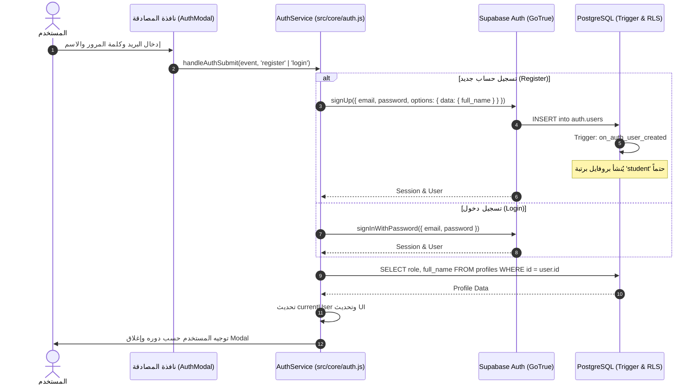

# خطة تنفيذ المرحلة 0.1 — تأسيس المصادقة والأمان السحابي
## Phase 0.1 Implementation Plan: Authentication & Backend Security Foundation

> **المشروع:** Accountera — منصة محاكاة المحاسبة  
> **المرحلة:** Phase 0.1 (Foundation Only)  
> **الهدف:** تأسيس مصادقة سحابية حقيقية عبر Supabase Auth، حماية قاعدة البيانات بسياسات RLS دقيقة، ومنع تزييف الهويات والصلاحيات، دون كسر أي وظيفة محاسبية أو واجهة حالية.

---

## 1. الملفات التي سيتم تعديلها (Files to Modify)

1. **`src/core/auth.js`**
   - استبدال التخزين المحلي الوهمي (Mock Auth) بربط حقيقي مع `SupabaseService.client.auth`.
   - تنفيذ عمليات: `signUp`، `signInWithPassword`، `signOut`، `getSession`، و `onAuthStateChange`.
   - إزالة حقل اختيار الدور (`authRole` dropdown) من نموذج إنشاء الحساب (التسجيل دائماً `student`).
   - تنظيف وتأمين نافذة الدخول السريع (`quickLogin`):
     - حظرها في بيئة الإنتاج (`accountera.vercel.app`).
     - إتاحة نمط فحص محلي فقط للمطورين مع استخدام بيانات حسابات اختبارية أو وضع علامة واضحة `(بيئة اختبار محلية)` تمنع خلطها مع الهوية السحابية.
   - عرض أخطاء الدخول والتسجيل بوضوح باللغة العربية داخل الـ Modal بدلاً من الإغلاق الفوري.
   - معالجة مؤشر التحميل (Loading State) أثناء انتظار رد Supabase Auth.
   - مزامنة الجلسة مع الكاش المحلي `accountera_user` لأغراض سرعة الـ UX فقط دون اعتباره مصدراً موثوقاً للصلاحيات.

2. **`src/core/supabase-client.js`**
   - تحديث دالة `submitStudentWork` لربط التسليم بـ `auth.uid()` الحقيقي الخاص بالمستخدم المصادق.
   - توفير دوال مساعدة لجلب الملف الشخصي `getUserProfile(userId)` ومزامنة البيانات.
   - التأكد من جاهزية العميل للتعامل مع الـ Auth Events.

3. **`src/ui/teacher-dashboard-view.js`**
   - التأكد من التعامل بسلاسة مع سياسة الـ RLS الجديدة التي تسمح فقط للـ `staff` (المعلمين والمدراء) بجلب التسليمات، مع معالجة واجهة المستخدم إذا كان الحساب طالباً أو غير مصادق.

---

## 2. الملفات التي سيتم إنشاؤها (Files to Create)

1. **`supabase/migrations/20260921_phase0_1_auth_foundation.sql`**
   - تفعيل الامتدادات ودوال الفحص المساعدة `is_admin()` و `is_staff()`.
   - إنشاء مشغّل قاعدة البيانات `on_auth_user_created` لإنشاء `public.profiles` تلقائياً لكل مستخدم مسجل برتبة `student`.
   - مشغّل حماية الدور `protect_profile_role` لمنع أي مستخدم من ترقية رتبته عبر `UPDATE`.
   - استبدال سياسات RLS المفتوحة السابقة بسياسات دقيقة لكل جدول (`profiles`, `companies`, `student_submissions`, `subscriptions`).
   - منح الصلاحيات الدقيقة (`GRANTS`).

2. **`test-auth-security-regression.js`**
   - اختبار آلي يتحقق من:
     - رفض تعيين أدوار غير مصرح بها من العميل.
     - صحة قواعد التحقق من كلمات المرور والبريد.
     - استقلالية النواة المحاسبية وسلامة تدفق البيانات.

3. **`PHASE_0_1_IMPLEMENTATION_REPORT.md`**
   - التقرير الشامل بعد إتمام التنفيذ.

---

## 3. المكونات المحمية غير القابلة للمساس (Files That MUST Remain Untouched)

> [!CAUTION]
> **ممنوع تعديل أي من الملفات التالية أو المساس بقواعدها وسلوكها:**
> - `src/core/engine/accountera-accounting-core.js` (النواة المحاسبية)
> - `src/core/engine/egyptian-coa.js` (الدليل المحاسبي المصري)
> - `src/core/engine/document-transaction-engine.js` (محرك فواتير ومستندات VAT)
> - `src/core/engine/egyptian-simulation-modules.js` (محاكي التسويات)
> - `src/core/engine/career-paths-and-mentor.js` (المسارات والمدقق الآلي)
> - `test-accounting-regression.js` (اختبارات الانحدار الـ 9 المعتمدة)

---

## 4. تدفق المصادقة الجديد (Authentication Flow)



---

## 5. نموذج الأدوار الآمن (Role Model)

1. **الأدوار المدعومة:** `student`, `teacher`, `admin`.
2. **قاعدة الإنشاء الافتراضية:** كل تسجيل جديد ينشئ دور `student` حصرياً عبر الـ Database Trigger.
3. **حظر تزييف الصلاحيات:**
   - تم استبعاد حقل اختيار الدور من شاشة التسجيل.
   - أي محاولة لإرسال `role: 'admin'` في الطلب تتجاهلها قاعدة البيانات لأن الـ Trigger يفرض `'student'`.
   - تم وضع مشغل `protect_profile_role` يمنع تعديل حقل `role` في جدول `profiles` إلا للمدير الفعلي.

---

## 6. سياسات RLS المحدثة (RLS Policies Plan)

### دالتا الفحص الأمني (Security Definer Helpers)
```sql
CREATE OR REPLACE FUNCTION public.is_admin()
RETURNS BOOLEAN AS $$
BEGIN
  RETURN EXISTS (
    SELECT 1 FROM public.profiles
    WHERE id = auth.uid() AND role = 'admin'
  );
END;
$$ LANGUAGE plpgsql SECURITY DEFINER;

CREATE OR REPLACE FUNCTION public.is_staff()
RETURNS BOOLEAN AS $$
BEGIN
  RETURN EXISTS (
    SELECT 1 FROM public.profiles
    WHERE id = auth.uid() AND role IN ('teacher', 'admin')
  );
END;
$$ LANGUAGE plpgsql SECURITY DEFINER;
```

### سياسات جدول `profiles`
* `SELECT`: الطالب يرى بروفايله الخاص (`auth.uid() = id`)، والـ staff يرى الجميع.
* `UPDATE`: الطالب يعدل فقط بياناته الذاتية (`auth.uid() = id`)، ومشغل الحماية يمنع تغيير الدور.
* `INSERT`: يتم عبر Trigger السيرفر فقط.

### سياسات جدول `companies`
* `SELECT`: متاح للجميع (Authenticated & Anon) لضمان عدم كسر تحديات المحاكاة للزوار والطلاب.
* `INSERT/UPDATE/DELETE`: محصور بالمدير فقط `is_admin()`.

### سياسات جدول `student_submissions`
* `INSERT`: متاح للمستخدم المصادق فقط وشرط `auth.uid() = user_id`.
* `SELECT`: الطالب يرى فقط تسليماته (`auth.uid() = user_id`)، بينما المعلم والمدير يرى جميع التسليمات `is_staff()`.
* `UPDATE/DELETE`: محظور على الطلاب.

### سياسات جدول `subscriptions`
* `SELECT`: الطالب يرى اشتراكه فقط (`auth.uid() = user_id`)، والمدير يرى الجميع.
* `INSERT/UPDATE/DELETE`: للمدير فقط في هذه المرحلة.

---

## 7. خطة الاختبار والتحقق (Test Plan)

1. **فحص النواة المحاسبية (Accounting Regression):**
   - تشغيل `node test-accounting-regression.js` والتأكد من اجتياز 9/9.
2. **فحص تسجيل الحساب الجديد:**
   - التسجيل عبر Supabase Auth والتأكد من أن الدور المسند تلقائياً هو `student`.
3. **فحص الدخول والخروج:**
   - تسجيل الدخول بالحساب والتأكد من استعادة الجلسة عند عمل Refresh.
   - تسجيل الخروج والتأكد من تنظيف الجلسة والذاكرة المؤقتة.
4. **فحص حظر الترقية الذاتية:**
   - محاولة تعديل `role` في المتصفح والتأكد من رفض قاعدة البيانات لتغيير الصلاحيات.
5. **فحص حماية تسليمات الطلاب:**
   - التحقق من أن الطالب لا يمكنه قراءة تسليمات طالب آخر.

---

## 8. استراتيجية التراجع (Rollback Strategy)

1. في حال حدوث أي خطأ غير متوقع في مصادقة Supabase:
   - تم بناء `AuthService` مع آلية فحص اتصال هادئة (`graceful fallback`) بحيث إذا تعذر الاتصال بـ Supabase (مثلاً وضع عدم الاتصال)، يمكن تفعيل وضع القراءة المحلي دون توقف التطبيق.
2. ملف الترحيل مصمم ليكون قابلاً للتنفيذ المتكرر (`Idempotent`) باستخدام `CREATE OR REPLACE` و `DROP POLICY IF EXISTS`.
3. يمكن استعادة سياسات RLS الأصلية بنص SQL مخصص في ثوانٍ معدودة إذا تطلب الأمر.

---

## 9. تحليل المخاطر (Risks & Mitigations)

| الخطر | الإجراء الاحترازي |
|---|---|
| عدم قدرة المستخدمين غير المسجلين على تصفح الشركات | جعل قراءة جدول `companies` متاحة للعموم `TO public` |
| تكرار استدعاءات RLS والتسبب في حلقة مفرغة (Infinite Recursion) | استخدام دوال `SECURITY DEFINER` المستقلة (`is_admin`, `is_staff`) |
| حظر طلاب المحاكي المحليين غير المسجلين | حفظ التسليم في `localStorage` كـ Local Draft بجانب محاولة إرساله للسحابة إذا كان مسجلاً |
